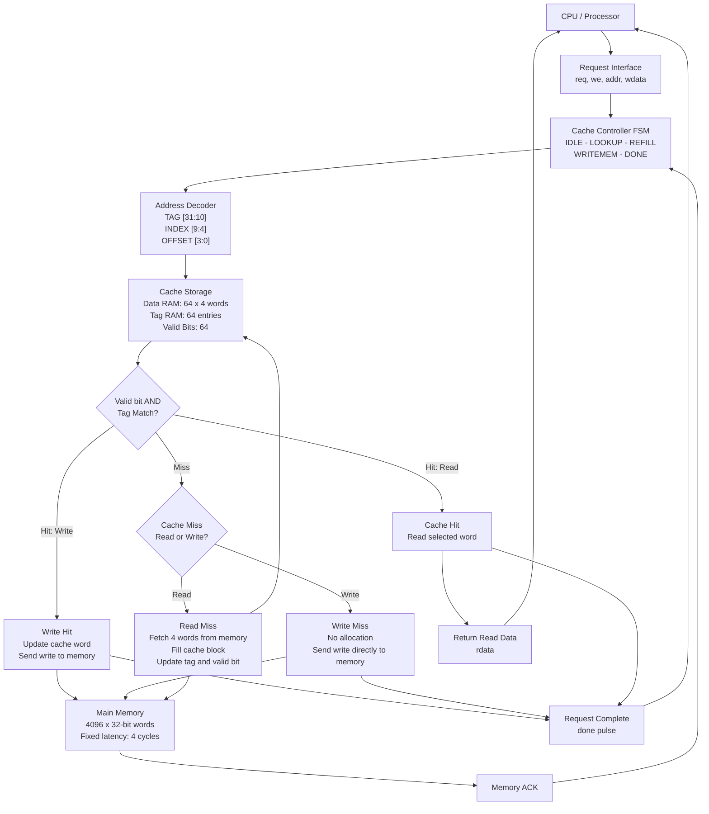

# Direct-Mapped Cache Controller Architecture

## Configuration

- Cache capacity: 1 KB
- Block size: 16 bytes
- Cache lines: 64
- Words per block: 4
- Address width: 32 bits
- Mapping: Direct-mapped
- Write policy: Write-through
- Write miss policy: No-write-allocate

## Address Format

```text
| TAG (22 bits) | INDEX (6 bits) | OFFSET (4 bits) |
|    [31:10]    |     [9:4]     |      [3:0]      |
```

The offset selects one of four 32-bit words using bits [3:2].
Bits [1:0] select the byte within a word.

## Architecture Diagram



## Write Policy

- Write hit: Update cache and main memory.
- Write miss: Write directly to main memory without allocating a cache block.
- Read miss: Fetch the complete four-word block into cache.

## Controller States

1. IDLE
2. LOOKUP
3. REFILL
4. WRITEMEM
5. DONE
