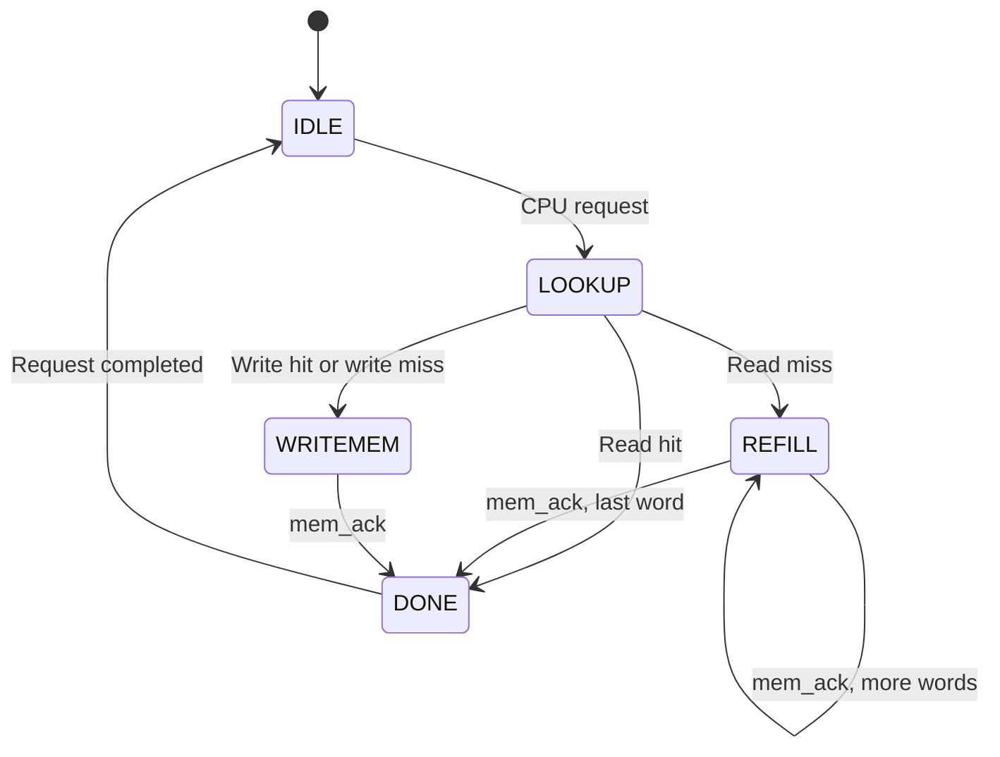

# Cache Controller Finite State Machine (FSM)

## 1. Overview

The cache controller uses a five-state Finite State Machine (FSM) to manage CPU requests, cache lookups, memory refills and write operations.

The five states are:

1. IDLE
2. LOOKUP
3. REFILL
4. WRITEMEM
5. DONE

## 2. FSM State Diagram

## 3. State Descriptions

| State | Function |
|---|---|
| IDLE | Waits for a CPU request and captures the request details. |
| LOOKUP | Checks the valid bit and stored tag to identify a cache hit or miss. |
| REFILL | Fetches four words from main memory on a read miss. |
| WRITEMEM | Sends write requests to main memory and waits for acknowledgement. |
| DONE | Generates a completion pulse and returns to IDLE. |

## 4. Control Signal Outputs

| State | mem_req | mem_we | done |
|---|---:|---:|---:|
| IDLE | 0 | 0 | 0 |
| LOOKUP | 0 | 0 | 0 |
| REFILL | 1 | 0 | 0 |
| WRITEMEM | 1 | 1 | 0 |
| DONE | 0 | 0 | 1 |

## 5. Memory Interface Handshake

The controller communicates with main memory using a request-acknowledgement handshake.

- mem_req initiates a memory operation.
- mem_we indicates whether the operation is a write.
- mem_ack indicates that the memory operation has completed.

During a read miss, the REFILL state receives four words from main memory. The memory address increments after each acknowledgement.

Once the final word is received, the controller updates the valid bit and tag before completing the request.

## 6. Write Policy

The baseline implementation uses:

- Write-through: Every write hit updates both the cache and main memory.
- No-write-allocate: A write miss updates main memory without loading the block into the cache.

## 7. Conclusion

The five-state FSM coordinates cache lookup, memory communication, block refill and request completion. It ensures that CPU requests are handled in the correct sequence while maintaining communication with main memory.
