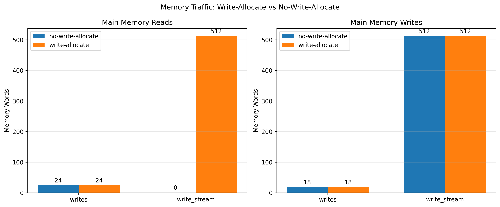

# Results and analysis (simulation, Icarus Verilog)

Configuration: 1 KB, 16-byte blocks, write-through / no-write-allocate, main-memory latency LAT = 4 cycles per word.
Every trace passed the data check (each read compared with a reference memory).
Source files: results_table.csv, lat_sweep.csv, sweep.csv (generated with tb/tb_trace.v); write_policy_traffic.csv (generated with tb/tb_traffic.v, sections 4 below); synthesis results are in docs/synthesis/.

## Measured timings (LAT = 4)
- Cache hit: 3 cycles
- Read miss with 16-byte block: 23 cycles, so the miss penalty is 20 cycles
- Miss penalty = words per block x (LAT + 1): 8 B block = 10, 16 B = 20, 32 B = 40 cycles
- No cache (CPU reads one word straight from memory): LAT cycles, i.e. 4

AMAT = hit time + miss rate x miss penalty = 3 + miss_rate x 20 (for the default configuration).
Example (sequential): 3 + 0.25 x 20 = 8.0 cycles, matching the simulation.

## 1. Results table (1 KB / 16 B / LAT 4)

| Trace | Accesses | Hits | Misses | Hit rate | Miss rate | AMAT (cycles) |
|---|---|---|---|---|---|---|
| sequential | 512 | 384 | 128 | 75.0% | 25.0% | 8.00 |
| random | 2000 | 479 | 1521 | 23.9% | 76.0% | 18.21 |
| repeated | 800 | 796 | 4 | 99.5% | 0.5% | 3.10 |
| stride16 | 1000 | 0 | 1000 | 0.0% | 100% | 23.00 |
| stride1024 | 1000 | 0 | 1000 | 0.0% | 100% | 23.00 |
| matrix_rowmajor | 1024 | 768 | 256 | 75.0% | 25.0% | 8.00 |
| matrix_colmajor | 1024 | 0 | 1024 | 0.0% | 100% | 23.00 |
| writes | 38 | 27 | 11 | 71.1% | 28.9% | 8.53 |

Why:
- sequential and row-major: one miss brings in 4 words, the next 3 accesses hit (spatial locality, 75%).
- repeated: the same 16 words fit in the cache, so after the first 4 misses everything hits (temporal locality).
- stride16: every access is in a new block, so there is never a hit.
- stride1024 and column-major: addresses 1 KB apart (or a stride that reuses only a few indices) keep evicting each other, so conflict misses give 0%.
- random: the 4 KB range is 4x the cache, so only about 24% of accesses land on a resident block.

## 2. Baseline comparison: cache versus no cache

A no-cache design pays LAT cycles for every access. Average cycles per access:

| Trace | LAT 4 cache / none | LAT 10 | LAT 20 | LAT 50 | LAT 100 |
|---|---|---|---|---|---|
| sequential | 8.0 / 4 | 14.0 / 10 | 24.0 / 20 | 54.0 / 50 | 104.0 / 100 |
| random | 18.2 / 4 | 36.5 / 10 | 66.9 / 20 | 158.1 / 50 | 310.2 / 100 |
| repeated | 3.1 / 4 | 3.2 / 10 | 3.4 / 20 | 4.0 / 50 | 5.0 / 100 |
| matrix_rowmajor | 8.0 / 4 | 14.0 / 10 | 24.0 / 20 | 54.0 / 50 | 104.0 / 100 |
| matrix_colmajor | 23.0 / 4 | 47.0 / 10 | 87.0 / 20 | 207.0 / 50 | 407.0 / 100 |

Findings (these are honest results of this design, state them in the report):
1. The cache only wins when locality is high. `repeated` goes from 100 cycles to 5.0 at LAT 100 (20x faster). At LAT 4 it is only slightly better (3.1 versus 4) because the hit itself takes 3 cycles.
2. For sequential access the cache is about the same as no cache (or slightly worse). The reason is the memory model: each of the 4 words of a refill pays the full latency, with no burst advantage. A real memory delivers the rest of a block much faster than the first word, which would let sequential access win.
3. For random and column-major access the cache is much worse than no cache, because every miss fetches a whole block (4 words) but only 1 word is used.
4. Limitations to state: fixed-latency memory with no burst mode, write-through with no-write-allocate, one request at a time.

## 3. Parameter sweep (LAT 4, reads only)

Hit rate (%) and average cycles per access:

random.trace

| Cache | 8 B block | 16 B block | 32 B block |
|---|---|---|---|
| 256 B | 7.1% / 12.3 | 6.5% / 21.7 | 6.0% / 40.6 |
| 512 B | 12.7% / 11.7 | 11.9% / 20.6 | 12.2% / 38.1 |
| 1 KB | 23.3% / 10.7 | 23.9% / 18.2 | 24.2% / 33.3 |
| 2 KB | 43.8% / 8.6 | 47.5% / 13.5 | 49.9% / 23.0 |

matrix_colmajor.trace: 0.0% hit rate in all 12 configurations (cycles 13.0 / 23.0 / 43.0 for 8 / 16 / 32 B blocks).

Findings:
- Bigger cache raises the hit rate for random access (the working set is 4 KB, so the hit rate approaches 50% at 2 KB and would reach nearly 100% at 4 KB).
- A bigger block raises the hit rate a little, but it raises the miss penalty much more (10 / 20 / 40 cycles), so the average time gets worse. The 8-byte block gives the lowest AMAT here.
- Column-major stays at 0% because the 128-byte row stride only uses a few index values, so rows keep evicting each other. Making the cache bigger does not fix it, and a bigger block does not either.

## 4. Write policy: memory traffic

Data: write_policy_traffic.csv (reproduce with `bash scripts/run_traffic.sh`). Full write-up: write_policy_traffic.md. 1 KB cache, 16 B blocks, LAT 4, write-through.

| Trace | Policy | Hit rate | mem_reads | mem_writes | Total words | Avg cycles |
|---|---|---|---|---|---|---|
| writes | no-write-allocate | 71.1% | 24 | 18 | 42 | 8.53 |
| writes | write-allocate | 84.2% | 24 | 18 | 42 | 8.53 |
| write_stream | no-write-allocate | 0.0% | 0 | 512 | 512 | 8.00 |
| write_stream | write-allocate | 75.0% | 512 | 512 | 1024 | 13.00 |

Findings:
- The eight read-only traces give identical hits, misses and traffic under both policies, so WRITE_ALLOCATE only changes the write-miss path.
- Write-allocate pays off when a written block is used again: on `writes` the hit rate rises from 71.1% to 84.2% at identical traffic (42 words) and identical average time (8.53 cycles).
- Write-allocate costs a full block refill on every write miss. On `write_stream` (2 KB written once, never read) it doubles the traffic from 512 to 1024 words and raises the average from 8.00 to 13.00 cycles.
- The AMAT formula (3 + miss rate x 20) is only valid for read-dominated traces, because the 20-cycle penalty is a read-miss refill. A write miss without allocation sends one word to memory (about 8 cycles). Use the measured average for traces with writes: `write_stream` measures 8.00 cycles, the formula would give 23.00.

## 5. Synthesis (iCE40 HX8K, Yosys + nextpnr-ice40)

Full details: docs/synthesis/synthesis.md. Vivado was not available, so the open-source flow was used. Reproduce with `bash scripts/run_synth.sh`.

| Configuration | Logic cells | LUT4 | Flip-flops | Block RAM | Max frequency (after routing) |
|---|---|---|---|---|---|
| 1 KB, 64 lines | 740 / 7680 (9%) | 491 | 383 | 4 / 32 (12%) | 79.85 MHz |
| 512 B, 32 lines | 662 / 7680 (8%) | 412 | 352 | 4 / 32 (12%) | 79.90 MHz |

Findings:
- The critical path (12.52 ns for 1 KB) is the hit path: tag RAM read, 22-bit tag compare, then the control decision. 62% of it is routing delay, so the 79.85 MHz figure belongs to this device, not to the architecture.
- Halving the cache saves logic (740 to 662 cells) but not block RAM (4 in both): the count is set by the array width (32-bit data, 22/23-bit tags), not by depth. Frequency is almost unchanged (79.85 versus 79.90 MHz).
- The generic Yosys flow gives 30,922 cells and 9,935 flip-flops for 1 KB. That number is the cache arrays flattened into flip-flops (the generic flow has no memory primitives), not the cost of the design. Quote the iCE40 figures above.
- Of the 383 flip-flops, 128 are the statistics counters, which a production cache would not carry.
- The synthesised netlist was simulated at gate level and passes the trace testbench on all nine traces for both configurations.
- Limits: single device, no vendor-tool (Vivado) comparison, timing measured through a pin-count harness, no external I/O constraints.
