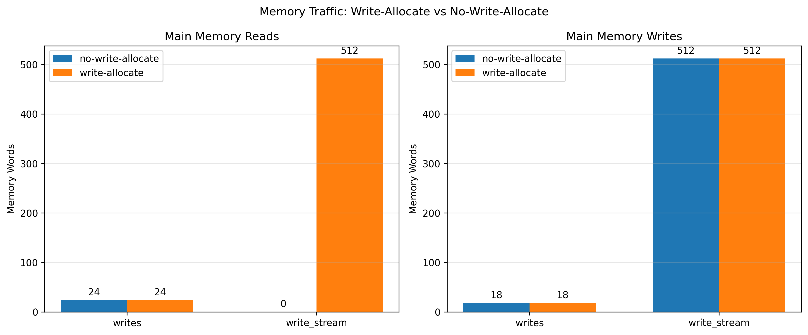

# Write-allocate versus no-write-allocate: memory traffic

Data: `write_policy_traffic.csv` — reproduce with `bash scripts/run_traffic.sh`
Configuration: 1 KB cache, 16 B blocks, write-through, LAT = 4 cycles per word.

`mem_reads` and `mem_writes` are counters in `rtl/dm_cache.v`. They count **words** moved
between the cache and main memory: `mem_reads` increments once per word accepted during a
refill, `mem_writes` once per word written through. Their sum is the memory traffic of the
run. Every run passed the data check.

## The trade-off

Write-allocate adds a full block refill on every write miss, and that traffic is wasted
unless the block is read or written again soon: on `write_stream.trace`, where 2 KB is
written once and never read, it doubles memory traffic from 512 to 1024 words and pushes the
average access from 8.00 to 13.00 cycles. It pays off only when the allocated block is
actually reused: on `writes.trace`, where every address written is read straight back, it
raises the hit rate from 71.1% to 84.2% at identical traffic (42 words) and identical average
latency (8.53 cycles).

## Results

| Trace | Policy | Hit rate | `mem_reads` | `mem_writes` | Total words | Avg cycles |
|---|---|---|---|---|---|---|
| `writes` (20 R, 18 W) | no-write-allocate | 71.1% | 24 | 18 | 42 | 8.53 |
| `writes` (20 R, 18 W) | write-allocate | 84.2% | 24 | 18 | 42 | 8.53 |
| `write_stream` (0 R, 512 W) | no-write-allocate | 0.0% | 0 | 512 | 512 | 8.00 |
| `write_stream` (0 R, 512 W) | write-allocate | 75.0% | 512 | 512 | **1024** | **13.00** |

The eight read-only traces in `traces/` contain no writes, and both policies give identical
hits, misses and traffic on all of them — confirming that `WRITE_ALLOCATE` changes only the
write-miss path of the FSM. Their figures are in the CSV.

`write_stream.trace` is kept in `docs/results/` rather than `traces/` because it exists only
for this study; `scripts/run_all.sh` and the shared results tables still cover the same eight
traces as before. `scripts/run_traffic.sh` regenerates it on every run.

## Note: the AMAT formula is not valid for write-heavy traces

`tb/tb_trace.v` prints `AMAT(formula) = 3 + miss_rate x 20`. The penalty of 20 cycles is
measured from a **read** miss, which refills a block. A write miss is far cheaper: with
no-write-allocate it sends one word to memory and does not refill at all, about 8 cycles.

| Trace | Measured avg cycles | `AMAT(formula)` |
|---|---|---|
| `write_stream` | 8.00 | 23.00 (2.9x too high) |
| `writes` | 8.53 | 8.79 (+3%) |

**Use the measured `avg_cycles_per_access` for any trace containing writes.** The existing
results table already does this correctly for `writes` (8.53, not 8.79), so no published
number needs changing.

## Memory Traffic Plot

**Takeaway:** Write-allocate doubles memory traffic for write_stream (512 to 1024 words), while both policies produce identical traffic for writes.