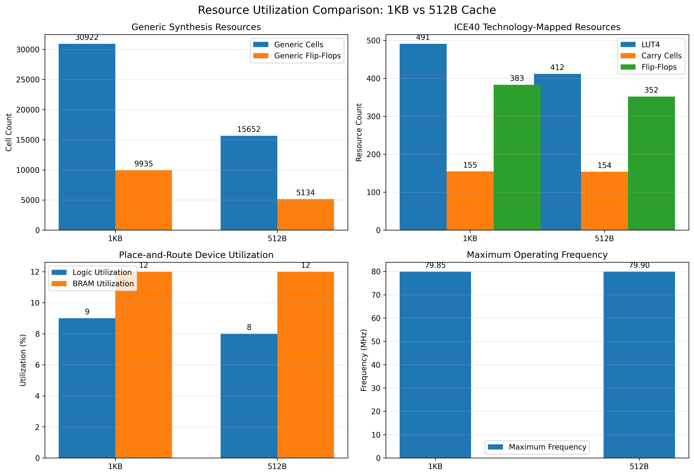

# Synthesis: resource utilisation and maximum frequency

**Owner:** Anusha (Controller, Memory Interface & Synthesis Lead)

**Design:** `rtl/dm_cache.v` — direct-mapped, write-through cache controller

**Reproduce:** `bash scripts/run_synth.sh`

---

## Summary

The cache controller was synthesised using the open-source Yosys and nextpnr-ice40 toolchain for the Lattice iCE40 HX8K FPGA.

Both cache configurations successfully passed post-synthesis gate-level simulation on all nine trace tests.

| Configuration | Logic cells (iCE40 HX8K) | Block RAM | Maximum frequency |
|---|---:|---:|---:|
| 1 KB, 64 lines, 16 B blocks (default) | 740 / 7680 (9%) | 4 / 32 (12%) | 79.85 MHz |
| 512 B, 32 lines, 16 B blocks | 662 / 7680 (8%) | 4 / 32 (12%) | 79.90 MHz |

The 512 B configuration uses fewer logic resources, while both configurations use the same number of block RAM primitives and achieve nearly identical maximum frequencies.

---

## Toolchain and target device

Vivado was unavailable in the development environment, so an open-source synthesis and place-and-route flow was used.

| Tool | Version / purpose |
|---|---|
| Yosys | 0.71 — generic synthesis and iCE40 technology mapping |
| nextpnr-ice40 | 0.11.1 — placement, routing and timing analysis |
| Target FPGA | Lattice iCE40 HX8K CT256 |
| Icarus Verilog | Gate-level simulation |

The target iCE40 HX8K device provides:

- 7,680 logic cells
- 32 embedded 4 Kbit block RAM primitives
- 206 I/O pins

Install the required tools on macOS using:

```bash
brew install yosys nextpnr-ice40 icestorm icarus-verilog
```

---

## 1. Resource utilisation

### 1.1 Generic Yosys synthesis

The generic synthesis results show the resources required before mapping the design to the target FPGA technology.

| Metric | 1 KB cache | 512 B cache |
|---|---:|---:|
| Total generic cells | 30,922 | 15,652 |
| Flip-flops (FFs) | 9,935 | 5,134 |

The generic synthesis flow does not map the cache arrays into FPGA memory primitives. Instead, the arrays are represented using flip-flops and multiplexing logic.

**These generic numbers must not be read as the cost of the design.** The generic flow has no memory primitives, so it implements the cache arrays as individual flip-flops plus multiplexer trees. The flip-flop count is essentially the storage in bits (see 1.2). Quote the iCE40 mapped figures in 1.3 and the placed-and-routed figures in 1.6 for the real cost.

### 1.2 Cache storage breakdown

| Storage element | 1 KB configuration | 512 B configuration |
|---|---:|---:|
| Data RAM | 8,192 bits | 4,096 bits |
| Tag RAM | 64 × 22 = 1,408 bits | 32 × 23 = 736 bits |
| Valid RAM | 64 bits | 32 bits |
| Total array storage | 9,664 bits | 4,864 bits |
| Generic Yosys FF count | 9,935 | 5,134 |
| Additional controller FFs | 271 | 270 |

The difference between the array storage and the generic FF count comes from controller state, including:

- FSM state
- Latched request information
- Refill counter
- `pending_write`
- Memory-side outputs
- Four 32-bit statistics counters

These controller registers account for approximately 271 FFs in the 1 KB configuration and 270 FFs in the 512 B configuration.

### 1.3 iCE40 technology-mapped resources

After technology mapping with Yosys `synth_ice40`, the resource counts are:

| Resource | 1 KB cache | 512 B cache |
|---|---:|---:|
| LUT4 | 491 | 412 |
| Carry cells | 155 | 154 |
| Flip-flops | 383 | 352 |
| Block RAM (BRAM) | 4 | 4 |

The smaller cache configuration reduces LUT4 usage from 491 to 412 and mapped flip-flops from 383 to 352.

The carry-cell count remains almost unchanged.

### 1.4 Flip-flop breakdown

The 383 mapped flip-flops in the 1 KB configuration can be approximately explained as follows:

| Component | Flip-flops |
|---|---:|
| Statistics counters | 128 |
| Memory-side outputs | 64 |
| Latched request | 63 |
| Valid RAM | 64 |
| BRAM read-data registers | ~52 |
| FSM and control | 9 |
| **Total** | **380** |

The breakdown is approximate; the mapped total is 383 FFs.

The additional mapped registers are partly explained by the BRAM read-data registers. The asynchronous RTL read behaviour is implemented using synchronous BRAM read ports, requiring registers around the memory interface.

The statistics counters account for 128 flip-flops, while approximately 52 registers are associated with the BRAM read-data mapping.

### 1.5 Block RAM utilisation

Both configurations use four `SB_RAM40_4K` primitives.

The iCE40 BRAM primitive supports a 256-word × 16-bit configuration. The cache data array is 32 bits wide and therefore uses two BRAMs.

The tag array is 22 or 23 bits wide and also requires two BRAMs.

| Array | BRAMs used |
|---|---:|
| Data RAM | 2 |
| Tag RAM | 2 |
| **Total** | **4** |

The BRAM count is primarily determined by the width of the arrays rather than their depth. This explains why both cache configurations use the same number of BRAM primitives.

The arrays map cleanly because the `idx` and `word` signals are slices of the latched `l_addr`, allowing Yosys to infer the memory structures.

### 1.6 Placed-and-routed device utilisation

The nextpnr place-and-route results for the iCE40 HX8K are:

| Resource | 1 KB cache | 512 B cache | Device capacity |
|---|---:|---:|---:|
| Logic cells | 740 (9%) | 662 (8%) | 7,680 |
| BRAM | 4 (12%) | 4 (12%) | 32 |
| I/O pins | 6 (2%) | 6 (2%) | 206 |
| Global buffers | 3 | 3 | 8 |

The design occupies less than one tenth of the available logic cells on the target device.

Reducing the cache size from 1 KB to 512 B reduces placed logic usage by 78 cells, while BRAM usage remains unchanged.

### 1.7 Resource comparison




The machine-readable results are stored in:

`docs/synthesis/resource_utilization.csv`

The CSV contains the generic synthesis counts, iCE40 mapped resource counts, placed-and-routed utilisation, and maximum frequency for both configurations.

The main comparison is:

| Metric | 1 KB | 512 B | Difference |
|---|---:|---:|---:|
| Generic cells | 30,922 | 15,652 | 15,270 fewer in 512 B |
| Generic FFs | 9,935 | 5,134 | 4,801 fewer in 512 B |
| LUT4 | 491 | 412 | 79 fewer in 512 B |
| Carry cells | 155 | 154 | 1 fewer in 512 B |
| Mapped FFs | 383 | 352 | 31 fewer in 512 B |
| BRAM | 4 | 4 | No change |
| Placed logic cells | 740 | 662 | 78 fewer in 512 B |

The resource comparison shows that reducing cache capacity decreases the amount of logic and register storage required. However, the BRAM count remains the same because both configurations require the same number of memory primitives to implement their array widths.

---

## 2. Maximum frequency and timing analysis

### 2.1 Maximum frequency

The maximum operating frequencies reported by nextpnr after routing are:

| Configuration | Post-placement frequency | Post-route frequency |
|---|---:|---:|
| 1 KB cache | 88.83 MHz | 79.85 MHz |
| 512 B cache | 78.61 MHz | 79.90 MHz |

The post-route values are used as the final maximum-frequency results because they include routing delays.

The timing constraint supplied to nextpnr was 100 MHz.

The two configurations achieve nearly identical post-route frequencies. The 512 B configuration is marginally faster by 0.05%, which is within the expected variation caused by placement and routing.

This indicates that cache capacity affects resource utilisation more significantly than it affects the critical-path delay.

### 2.2 Critical path

The critical path for the 1 KB configuration is approximately 12.52 ns.

\[
f_{\max} = \frac{1}{12.52\text{ ns}} \approx 79.9\text{ MHz}
\]

The critical path passes through the tag RAM read, tag comparison, hit/control logic and routing before reaching the memory-address register clock-enable logic.

The approximate delay breakdown is:

| Critical-path component | Delay |
|---|---:|
| BRAM clock-to-output | 2.15 ns |
| Seven LUT4 logic levels | 2.47 ns |
| Routing (8 hops) | 7.80 ns |
| Setup time | 0.10 ns |
| **Total** | **12.52 ns** |

The critical path starts at:

`u_cache.tag_ram.0.0_RAM.RDATA_6`

The endpoint is the memory-address register clock-enable logic.

### 2.3 Timing observations

The critical path is a hit-path timing path:

1. Tag RAM read
2. Tag comparison
3. Hit and FSM control logic
4. Routing to the destination register

Routing contributes approximately 62% of the total critical-path delay.

The logic and BRAM contribution is approximately 4.73 ns, while routing contributes approximately 7.80 ns.

The logic-only equivalent frequency would be approximately 210 MHz, but the actual post-route result is limited by routing delay.

This demonstrates that routing, rather than the amount of cache storage, is the dominant timing limitation in this implementation.

The reported frequency is specific to the Lattice iCE40 HX8K target and should not be interpreted as a device-independent frequency for the cache architecture.

### 2.4 Timing harness

The complete cache interface contains 329 port bits, exceeding the 206 package I/O pins available on the target device.

A timing harness, `syn_wrap.v`, was therefore used for place-and-route timing analysis.

The harness exposes six pins and uses a shift-register input with a two-stage registered XOR output observation.

The critical path being measured remains inside the cache design.

The resource utilisation figures are taken from `dm_cache.v` itself, not from the timing harness.

---

## 3. Post-synthesis functional verification

After synthesis, the generated netlist is simulated using the Lattice iCE40 cell simulation model.

The simulation checks the synthesised implementation against the trace testbench.

The relevant simulation command is:

```bash
iverilog -g2012 -o sim_post \
  $(dirname $(command -v yosys))/../share/yosys/ice40/cells_sim.v \
  netlist.v rtl/main_mem.v tb/tb_trace.v
```

Both cache configurations passed all nine trace tests.

| Configuration | Trace tests passed | Result |
|---|---:|---|
| 1 KB cache | 9/9 | PASS |
| 512 B cache | 9/9 | PASS |

The post-synthesis simulations confirm that:

- Data checks pass on all nine traces.
- Hit and miss counts match the RTL simulation.
- Cycle counts match the RTL simulation.

The corresponding logs are:

- `docs/synthesis/logs/postsynth_sim_1KB.log`
- `docs/synthesis/logs/postsynth_sim_512B.log`

This provides functional evidence that the synthesised netlists preserve the expected cache behaviour for the tested traces.

---

## 4. Limitations and considerations

The synthesis and timing results should be interpreted with the following limitations.

### 4.1 Device-specific timing

The maximum-frequency results are for the Lattice iCE40 HX8K device.

Routing contributes approximately 62% of the critical-path delay, so the results are dependent on the target FPGA and its routing architecture.

### 4.2 No vendor-tool comparison

Vivado was unavailable in the development environment.

The results therefore use the open-source Yosys and nextpnr toolchain and do not provide a direct comparison against a vendor synthesis flow.

### 4.3 Statistics counters

The statistics counters account for 128 of the 383 mapped flip-flops in the 1 KB configuration.

These counters are included in the reported resource utilisation. They are measurement infrastructure, not part of a production cache, so a deployed version would have roughly a third fewer flip-flops (128 of 383).

### 4.4 Timing harness

The timing harness is required because the full cache interface has 329 port bits, exceeding the 206 available package I/O pins.

The harness reduces the external interface while retaining the critical path inside the cache.

### 4.5 Valid RAM implementation

The valid RAM remains implemented using flip-flops because of its one-cycle reset behaviour.

A generation-counter approach could be considered for a larger cache to reduce reset-related overhead.

### 4.6 Clock and I/O constraints

The design uses a single clock domain.

The reported timing analysis does not include a complete set of external I/O timing constraints.

---

## 5. Reproducing the synthesis results

Run the synthesis flow from the repository root:

```bash
bash scripts/run_synth.sh
```

The script performs:

1. Generic Yosys synthesis.
2. iCE40 technology mapping.
3. nextpnr placement and routing.
4. Resource utilisation extraction.
5. Maximum-frequency extraction.
6. Post-synthesis netlist simulation for both configurations.
7. CSV and log generation.

The machine-readable resource results are written to:

`docs/synthesis/resource_utilization.csv`

Generate the resource comparison chart separately using:

```bash
python3 scripts/plot_resource_utilization.py
```

---

## 6. Generated files

| File | Description |
|---|---|
| `resource_utilization.csv` | Machine-readable synthesis and resource utilisation results for both configurations |
| `scripts/plot_resource_utilization.py` | Script used to generate the resource comparison chart |
| `resource_comparison.png` | Resource comparison chart for the 1 KB and 512 B configurations |
| `resource_table.png` | Screenshot of the resource utilisation table |
| `device_utilisation.png` | Screenshot of nextpnr device utilisation output |
| `max_frequency.png` | Maximum-frequency result visualisation |
| `critical_path.png` | Critical-path visualisation |
| `critical_path_1KB.txt` | Annotated critical-path report |
| `syn_wrap.v` | Timing harness used for place-and-route analysis |
| `logs/yosys_generic_*.log` | Generic Yosys synthesis logs |
| `logs/yosys_ice40_*.log` | iCE40 technology-mapping logs |
| `logs/nextpnr_*.log` | Placement, routing and timing logs |
| `logs/postsynth_sim_*.log` | Post-synthesis simulation logs |

---

## Conclusion

The synthesis results demonstrate that both cache configurations fit comfortably within the resource limits of the Lattice iCE40 HX8K.

The 512 B configuration reduces LUT4 usage from 491 to 412 and placed logic cells from 740 to 662. However, both configurations require four BRAM primitives and achieve approximately 79.9 MHz after routing.

The critical path is dominated by routing delay rather than cache capacity. Both synthesised configurations also pass all nine post-synthesis trace tests.

Overall, the results show that the cache controller is functionally preserved through synthesis and uses a relatively small portion of the target FPGA's available resources.
